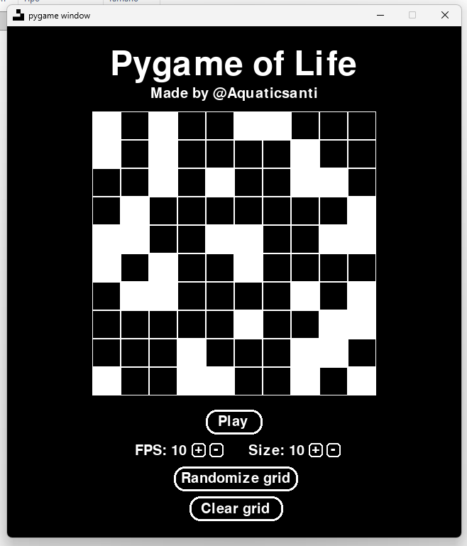

# PygameOfLife
A recreation of Conway's Game Of Life, written in PyGame!

See more about Conway's Game Of Life [here](https://en.wikipedia.org/wiki/Conway%27s_Game_of_Life).

It features all you'd expect from a recreation, including
- Changing grid sizes
- Changing simulation speed
- Randomizing the grid
- Clearing it

# Downloads
Try it out at the latest [release](https://github.com/Aquaticsanti/PygameOfLife/releases/latest)!

> [!IMPORTANT]
> PygameOfLife is only available for Windows, as I don't have the resources to build for Linux, MacOS, or other operating systems.

# Building
To build, use [PyInstaller](https://pyinstaller.org/en/stable/)!

First, install dependencies:
- [pygame-ce](https://pypi.org/project/pygame-ce/)
- [numpy](https://pypi.org/project/numpy/)

Then, clone the repository
```
git clone https://github.com/Aquaticsanti/PygameOfLife.git
```

And inside the repository, run
```
pyinstaller PygameOfLife.spec
```
# Screenshot

# AI Usage
Slight AI help was required for NumPy and Pygame modules (which I have little to no experience with), as well as with debugging.

#

This project is not affiliated with Pygame or Pygame-ce.